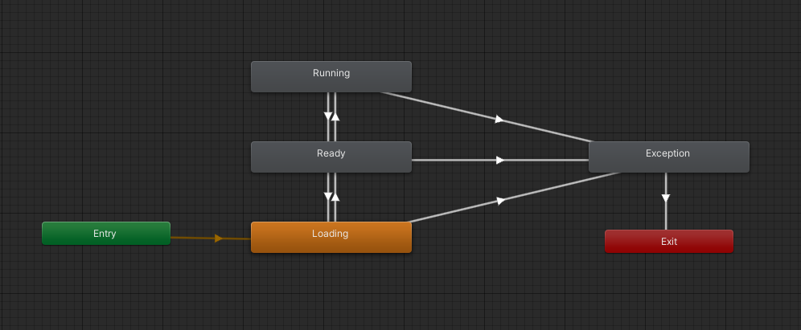

# Deeplearing Scheduler

This is a scheduler to run and manage deep learning task.

Every task should implement `handlerAbstract.Handler` which is an Abstract Class.

Set a config file like `handler-config.json` as input for `main.py` to start a handler to run tasks.

Here is the finite state machine of a handler


### Run a scheduler to start some tasks

```shell
python "./main.py" -c handler-config.json -t task-config.json
```

### Handler Config

> Each handler can be assigned several tasks by the controller.
> 
> Each handler should implement `AbstractHandler` with `run`, `load_data`, `ready`, `exception`, `exit` methods.

```
{
    "handler_list": List<HandlerConfigObject>
    "handler_dir": string, // the custom handlers directory, default "handler"
}
```

HandlerConfigObject

```
id: handler_id, the default path of handler module will be './handler/handler{id}.py'
name: handler name
description: handler description
```

### Task Config

> This config file is to describe the tasks you want to run on handlers.
> 
> Like how many seconds of the total running time, how many fps you want for a task.

Task Configuration:
```
{
    "task_list": List<TaskConfigObject>
}
```
TaskConfigObject Attributes:
```
HandlerId: the handler id of tasks to be assigned.
Period: the amount of each task per 1 second, e.g. 30(fps) mean 30 tasks per 1 seconds
Deadline: the relative deadline of each task (second)
ReleaseTimeDelay: the delay of first release time (second)
RunningTime: the running time of tasks (second), 1s is a period.
Dependencies: the dependencies of tasks
Priority: the priority of tasks
```

#### SIMO/DAG Task Config (with Non-Partitionable Tasks Support)

> For SIMO/DAG experiments, use a config file with a `dag_list` and optionally enable non-partitionable tasks:

```
{
  "RunningTimeFactor": 1.5,
  "NonPartitionablePercentage": 15, // percentage of tasks that are non-partitionable (optional)
  "NonPartitionableConfig": {      // config for non-partitionable tasks (optional)
    "HandlerId": 5,
    "WorstRunningTime": 150,
    "Priority": 2
  },
  "dag_list": [ ... ]
}
```
- `NonPartitionablePercentage`: (optional) Percentage of tasks to randomly mark as non-partitionable (e.g., 15 for 15%).
- `NonPartitionableConfig`: (optional) Default config for non-partitionable tasks.
- Each generated task will have an `IsNonPartitionable` flag.

### How to Run with Non-Partitionable Tasks

1. **Prepare your SIMO/DAG config** with the `NonPartitionablePercentage` and `NonPartitionableConfig` fields as shown above (see `TaskConfigs/simo/test_non_partitionable.json` for an example).
2. **Run your experiment** as usual:

```shell
python main.py -c handler-config.json -t TaskConfigs/simo/test_non_partitionable.json -a baseline
```

- The system will randomly select the specified percentage of tasks as non-partitionable.
- Non-partitionable tasks will not be merged in fine-grained adjustment and are tracked in statistics and visualizations.

### Test a handler

```shell
python "./handler/handler1.py"
```

### Autopilot Task

```shell
python "./Autopilot/test.py" -width 100 -height 100 -input "./Autopilot/img.jpg" --debug=True
```


## SIMO Experiment

### Parameter Sensitivity Experiment

Activate the Python environment that should run the experiment, then launch the
complete 18-point, five-repetition study with one command:

```bash
cd /experiment/zexin/ATC23/DeepLearningScheduler
PYTHON_BIN="$(command -v python)" ./experiments/run_parameter_sensitivity.sh
```

For example, with Conda:

```bash
conda activate <environment-name>
cd /experiment/zexin/ATC23/DeepLearningScheduler
PYTHON_BIN="$(command -v python)" ./experiments/run_parameter_sensitivity.sh
```

The wrapper pulls the latest commit with `git pull --ff-only`, resumes completed
runs, executes all 90 runs, validates the artifacts, and writes the CSV, JSON,
and LaTeX table files under
`taskdata/parameter_sensitivity/agx_high_load_v1/report/`. The source tree must
be clean. `PYTHON_BIN` records and uses the Python executable from the active
environment, so the same command works with Conda, `venv`, or another managed
environment.

For a Mac/MPS validation run, use:

```bash
cd "/Users/rentao/Documents/Github Projects/ATC23/DeepLearningScheduler"
SKIP_GIT_PULL=1 PYTHON_BIN="$(command -v python)" \
  ./experiments/run_parameter_sensitivity.sh \
  --device mac --power-mode AC --torch-device mps \
  --output-root taskdata/parameter_sensitivity/mac_validation
```

The default workload uses AGX Orin timing profiles. A Mac run validates the
pipeline but does not replace the final AGX Orin paper measurements. See
[`experiments/PARAMETER_SENSITIVITY.md`](experiments/PARAMETER_SENSITIVITY.md)
for the parameter grid, workload definition, dry-run command, and artifact
schema.

### Baseline
```
python "./main.py" -c "./simo-handler_config.json" -t "./TaskConfigs/simo-baseline-nano.json" -a "baseline"

# agx loose
python "./main.py" -c "./simo-handler_config.json" -t "./TaskConfigs/simo/agx_loose.json" -a "baseline"

# agx tight
python "./main.py" -c "./simo-handler_config.json" -t "./TaskConfigs/simo/agx_tight.json" -a "baseline"

# tx2 loose
python "./main.py" -c "./simo-handler_config.json" -t "./TaskConfigs/simo/tx2_loose.json" -a "baseline"

# tx2 tight
python "./main.py" -c "./simo-handler_config.json" -t "./TaskConfigs/simo/tx2_tight.json" -a "baseline"
```

### Non-Partitionable Tasks Experiment (NEW)
```
python "./main.py" -c "./simo-handler_config.json" -t "./TaskConfigs/simo/test_non_partitionable.json" -a "baseline"
```
- This will run with 15% of tasks as non-partitionable (see config for details).
- You can change the percentage or config as needed.

### Task Progress Tracker(Execution Feedback to adjust release time)
```
python main.py -c "./handler-config.json" -t "./TaskConfigs/simo-baseline-nano.json" -a "feedback"

# agx loose
python "./main.py" -c "./simo-handler_config.json" -t "./TaskConfigs/simo/agx_loose.json" -a "feedback"

# agx tight
python "./main.py" -c "./simo-handler_config.json" -t "./TaskConfigs/simo/agx_tight.json" -a "feedback"

```

### Fine Grained
```
python main.py -c "./handler-config.json" -t "./TaskConfigs/simo-baseline-nano.json" -a "fine-grained"

# agx loose
python "./main.py" -c "./simo-handler_config.json" -t "./TaskConfigs/simo/agx_loose.json" -a "fine-grained"

# agx tight
python "./main.py" -c "./simo-handler_config.json" -t "./TaskConfigs/simo/agx_tight.json" -a "fine-grained"
```

### Progress Tracker + Fine Grained Combination
```
python main.py -c "./handler-config.json" -t "./TaskConfigs/simo-baseline-nano.json" -a "feedback-fine-grained"

# agx loose
python "./main.py" -c "./simo-handler_config.json" -t "./TaskConfigs/simo/agx_loose.json" -a "feedback-fine-grained"

# agx tight
python "./main.py" -c "./simo-handler_config.json" -t "./TaskConfigs/simo/agx_tight.json" -a "feedback-fine-grained"
```

### Enable Skip Mode

Only Progress Tracker + Fine Grained Combination approach will enable skip mode.

But you can enable it manually.

Add --skipmode for signal_message in `control_signal.py`

Comment line 50 and uncomment <b>the 52nd line</b>


### Overhead measurement

```
python main.py -c "./overhead-handler.json" -t "./TaskConfigs/overhead-measure.json" -a "feedback"
```

### Clean taskdata without rename
```shell
rm taskdata/statistics_*
```

### New Scenario Experiment

```
## AGX
### Urban Navigation

python main.py -c "./handler-config.json" -t "./TaskConfigs/simo/new_scenarios/agx_loose_urban_navigation.json" -a "baseline"

### Emergency Obstacle Avoidance

python main.py -c "./handler-config.json" -t "./TaskConfigs/simo/new_scenarios/agx_loose_emergency_obstacle_avoidance.json" -a "baseline"

### Night Driving

python main.py -c "./handler-config.json" -t "./TaskConfigs/simo/new_scenarios/agx_loose_night_driving.json" -a "baseline"

## Nano

### Urban Navigation

python main.py -c "./handler-config.json" -t "./TaskConfigs/simo/new_scenarios/nano_loose_urban_navigation.json" -a "baseline"

### Emergency Obstacle Avoidance

python main.py -c "./handler-config.json" -t "./TaskConfigs/simo/new_scenarios/nano_loose_emergency_obstacle_avoidance.json" -a "baseline"

### Night Driving

python main.py -c "./handler-config.json" -t "./TaskConfigs/simo/new_scenarios/nano_loose_night_driving.json" -a "baseline"
```
